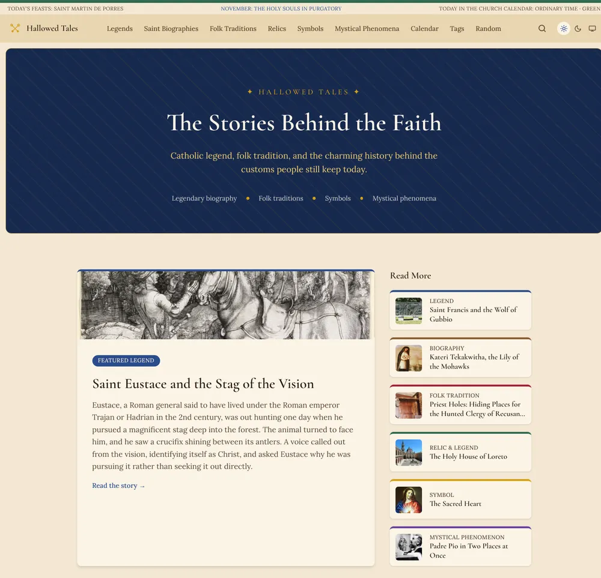
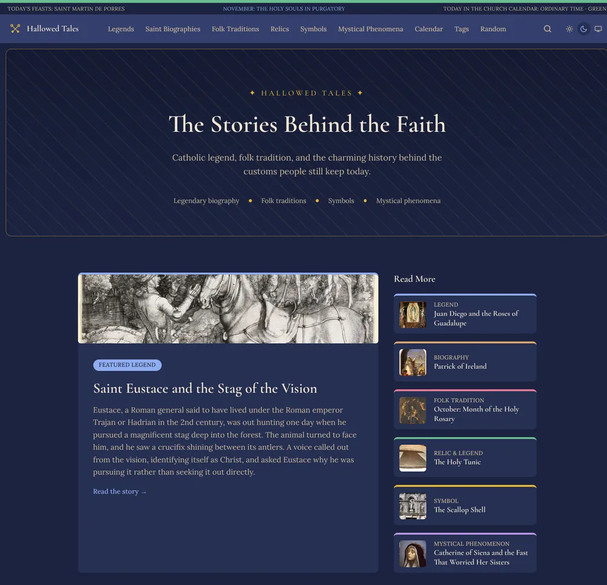
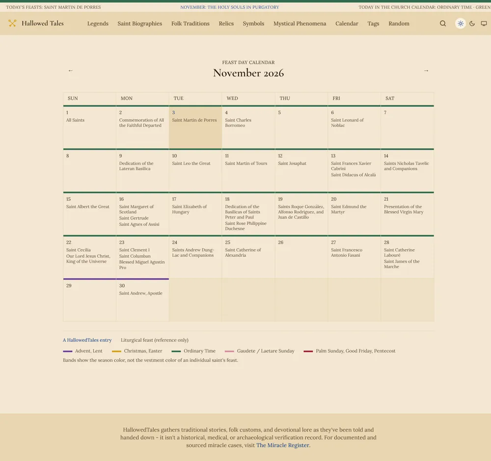
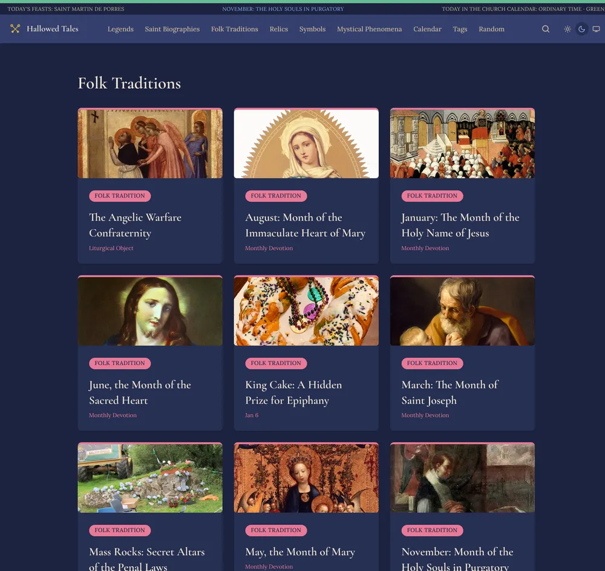

# HallowedTales

[](https://github.com/Labnerd-net/HallowedTales/actions/workflows/ci.yml)
[](LICENSE)
[](#licensing)

**Live site: [hallowedtales.com](https://hallowedtales.com)**

A content-driven site of Catholic saint and miracle *lore* - legends, folk traditions, relics,
symbols and saint biographies - built with Astro on Cloudflare Workers. Nearly 60 entries, no
database, full-text search, and a liturgical calendar computed from first principles.

<p align="center">
  
  
</p>

<p align="center">
  
  
</p>

Designed, built and written solo.

## Why this project exists

HallowedTales is the companion to [The Miracle Register](https://themiracleregister.org), a
site that holds itself to a Vatican-documentation and medical-verification standard. Lore
cannot meet that bar, and mixing the two would erode the Register's core promise, so this is a
separate site with its own data shape, tone and audience. The two cross-link wherever a story
overlaps a verified case.

## Engineering Highlights

- **No database, by design.** Cross-links, back-links, same-saint sections, tags and the saint
  index are all derived at build time from the content files. The relational needs are small
  and read-only, so a DB would add cost and failure modes for no benefit. If a runtime need
  appears, D1 is the planned option.
- **Content treated as code.** Frontmatter is validated by Zod schemas at build time (feast
  dates, image indexes, alt text, cross-references), and Vitest enforces editorial rules on
  the prose itself: plain hyphens, "Saint" spelled out, no entry referring to the site around
  it, and every `relatedLegends` / saint / Register reference resolving. A typo fails CI
  instead of silently dropping an entry.
- **Computed liturgical calendar.** Easter, Easter-relative feasts, fixed feasts and
  liturgical seasons (including Advent start detection) are calculated in `src/lib/liturgical/`
  and unit tested. They drive a `/calendar` page and a "today in the Church calendar" banner
  that stays live on prerendered pages as an Astro server island.
- **Search without a backend.** [Pagefind](https://pagefind.app) indexes only published entry
  pages at build time, so drafts never reach the index. The UI is a dialog calling the static
  index directly.
- **Security headers on every response.** A hashed Content-Security-Policy generated by
  Astro, plus `nosniff`, Referrer-Policy and frame protections applied through `public/_headers`
  for static assets and `src/middleware.ts` for on-demand responses, with one shared header
  definition.
- **Vendored reference data with drift detection.** Published Register slugs and the feast-day
  master list are synced into generated files from a sibling research repo, with a `--check`
  mode that reports drift. They stay vendored copies rather than runtime dependencies.
- **Accessible UI.** Skip link, keyboard-dismissible menus and dialogs, tracked focus,
  contrast-tuned dark mode tokens, and screen-reader text on calendar season bands.
- **Edge deployment.** Cloudflare Workers with static assets; CI runs typecheck, tests and the
  full build on every push and PR.

## Design decisions

- **Files over rows.** The content model is narrative pieces with variants, not one verified
  record per case. Markdown in the repo gives review via pull request, version history and
  zero operational overhead.
- **Two kinds of "related" story.** `variants[]` (inline) holds the same story with changed
  details, such as the Saint Nicholas window, chimney and pawnbroker versions. `relatedLegends[]`
  links distinct stories that share a motif, such as the Hubert and Eustace stags. Back-links
  are derived, so a reference only has to be authored once.
- **Same-saint links are computed, not curated.** Entries sharing a saint slug surface each
  other automatically, which keeps unrelated stories about one saint out of `relatedLegends`.
- **Separate site, not a feature of the Register.** Different sourcing standard, different
  audience, different tone. Keeping them apart protects the Register's guarantee.

## Content

Six collections, each an [Astro Content Collection](https://docs.astro.build/en/guides/content-collections/)
with its own Zod schema in `src/content.config.ts`:

| Collection | Covers |
|---|---|
| Legends | Saint-and-creature stories, patronage origins, founding and shrine legends |
| Traditions | Feast-day customs, liturgical-object and food traditions, naming and weather folklore |
| Relics | Biblical artifacts and legendary relics (True Cross, Holy Lance, Crown of Thorns) |
| Phenomena | Mystical phenomena from saints' lives (bilocation, levitation, luminosity) |
| Symbols | Chi-Rho, scallop shell, pelican, Tau cross, and how their use shifted across eras |
| Biographies | Condensed cradle-to-grave saint lives |

Every entry separates the legend as told from what the historical record supports, rather than
presenting tradition as documented fact.

## Tech Stack

- [Astro](https://astro.build) with the Cloudflare adapter, deployed to Cloudflare Workers
- TypeScript, Markdown/MDX content, Zod-validated frontmatter
- Tailwind v4
- Pagefind for static full-text search
- Vitest for unit and content-level tests
- GitHub Actions for CI

## Local Development

```
npm install
npm run dev         # http://localhost:4321
npm run typecheck
npm test
npm run build       # astro build + pagefind indexing
```

Deploying requires a `CLOUDFLARE_API_TOKEN` in a local `.env` (gitignored, not required for
dev, build or test).

## Related project

[The Miracle Register](https://themiracleregister.org) - the evidentiary counterpart, for
documented and medically reviewed cases.

## Licensing

- **Code:** [MIT](LICENSE).
- **Content** (saint and miracle lore write-ups, and other text published on the site): [CC BY 4.0](https://creativecommons.org/licenses/by/4.0/). Attribute as "HallowedTales, hallowedtales.com, CC BY 4.0". Provided without warranty.
